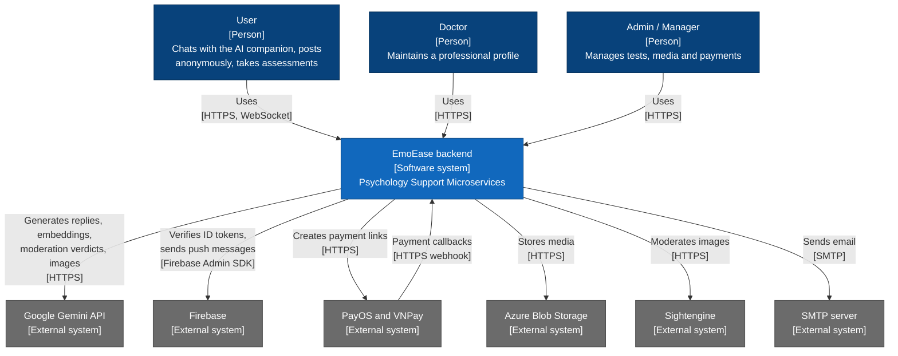
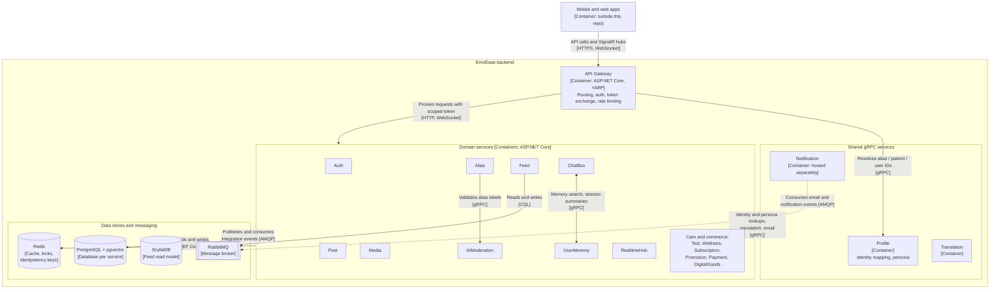
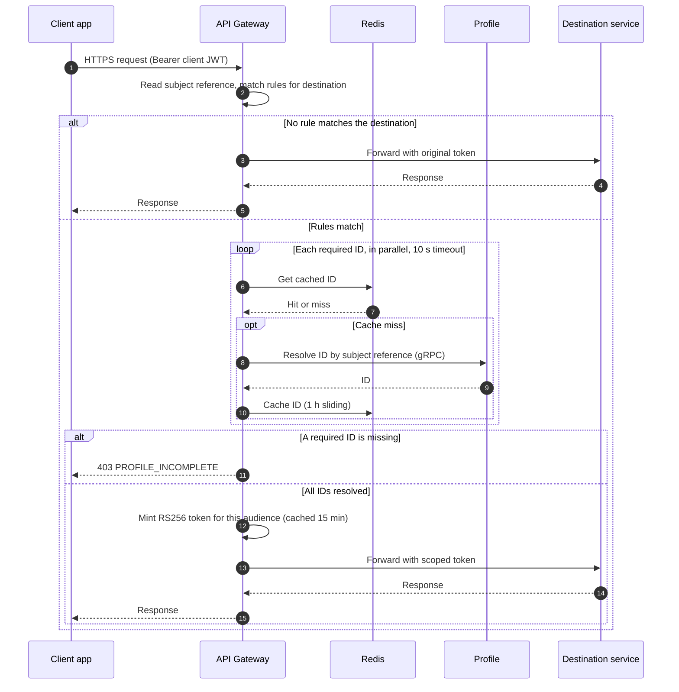
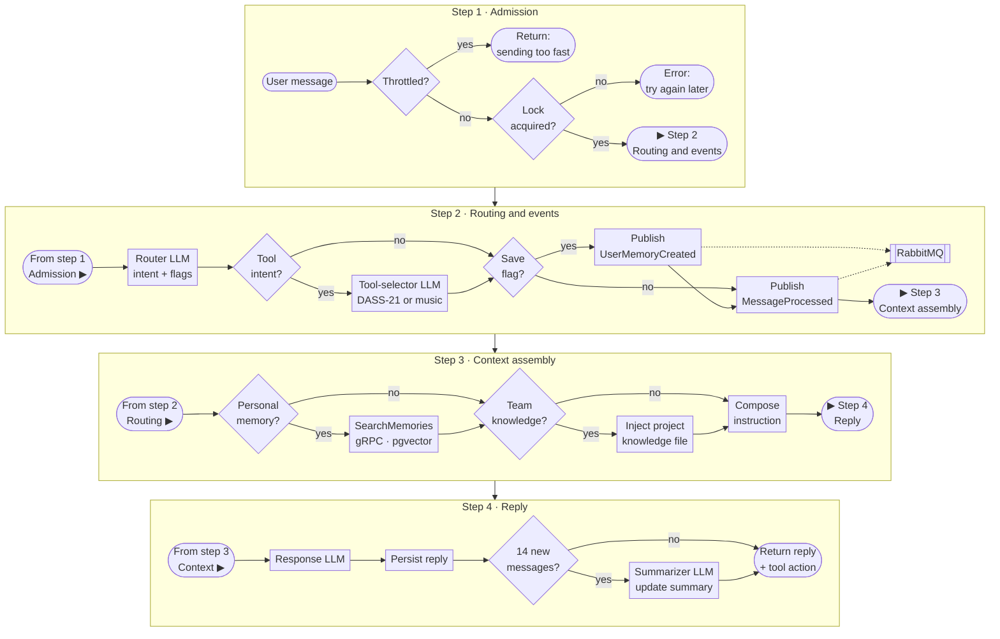
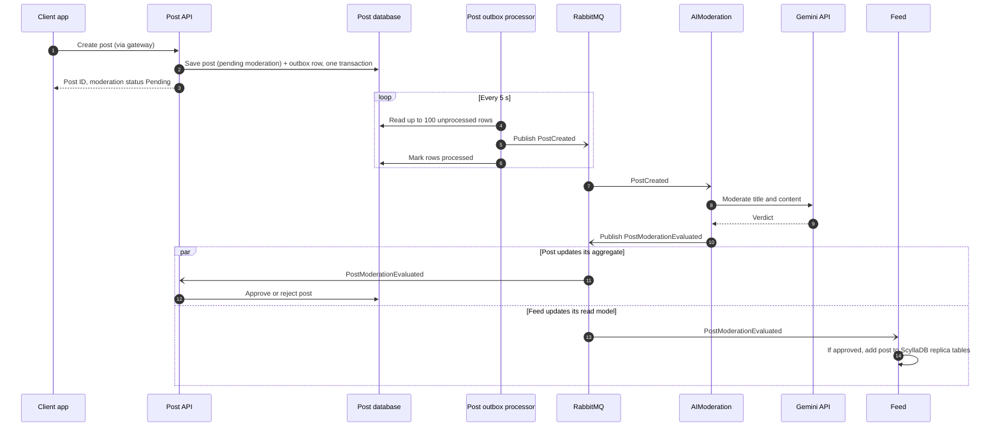
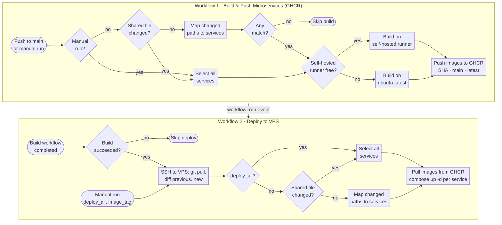

# Psychology Support Microservices

Backend for **EmoEase**, a mental-health support platform that combines an AI companion chat, an anonymous peer-support community and self-assessment tools, built as a set of .NET microservices.


📖 In-depth architecture documentation: **[DeepWiki](https://deepwiki.com/anht04/psychology-support-microservices)**

## Overview

People looking for emotional support often want two things that pull in opposite directions: a personalised experience (an assistant that remembers them) and strong anonymity (a community where nobody can link a post to their real identity or health data). EmoEase addresses both:

- **AI companion** that classifies each message, retrieves relevant long-term memories and can trigger in-app tools such as a DASS-21 assessment.
- **Anonymous community** with posts, nested comments, reactions and a personalised feed, where users act through public *aliases* instead of their account.
- **Clinical and wellness features**: patient profiles, DASS-21 self-assessments, wellness modules, challenges and mood journaling.
- **Commerce**: subscription packages, promo and gift codes, digital goods and PayOS / VNPay payments.

The backend is split into domain-aligned services behind a YARP API gateway. Services own their data, communicate synchronously over gRPC where an immediate answer is needed, and asynchronously over RabbitMQ (MassTransit) for everything else. The CI pipeline builds and deploys only the services whose files changed.

## Engineering Highlights

**Identity isolation at the gateway.** Client tokens carry only an opaque subject reference. For each request, the gateway adds the one identifier the destination needs (an alias ID for social services, a patient ID for clinical ones), so services such as Post and Feed work with aliases and never receive a patient ID.

**Reliable event publishing.** Several services (Post, Alias, UserMemory, Wellness, Media and others) write integration events to an **outbox table in the same transaction** as their state change; a background processor then publishes them to RabbitMQ. An event is delayed, not lost, if the broker is unavailable at commit time.

**Idempotency and concurrency control.** A shared MediatR pipeline behaviour (`IdempotentCommandPipelineBehaviour`) returns the stored response when a command is retried with the same idempotency key, and Redis locks serialise reaction changes on the same target.

**Multi-stage LLM pipeline.** ChatBox routes each message with a lightweight Gemini call, runs a tool-selector call only for tool intents, retrieves memories from UserMemory over gRPC only when needed, and composes an intent-specific instruction for the final response model.

**AI moderation in the event flow.** New posts are moderated asynchronously: Post publishes `PostCreated`, AIModeration evaluates it with Gemini and publishes the verdict, and both Post (approve or reject) and Feed (index approved posts) react to it.

**Selective CI/CD.** GitHub Actions maps changed paths to services, builds Docker images only for those services, pushes them to GHCR and redeploys only the affected containers on the VPS.

## Architecture

The diagrams follow the [C4 model](https://c4model.com/): a System Context view for people and external systems, then a Container view for the services inside the system. They are drawn as Mermaid flowcharts using C4 notation (element type in brackets, technology on each relationship) because Mermaid's native C4 syntax is experimental and lays out labels poorly on GitHub.

**Legend (all diagrams):** solid arrow = synchronous call or dependency (HTTP, gRPC, SignalR, database access); dashed arrow = asynchronous message or trigger (RabbitMQ event, workflow trigger). In sequence diagrams, `-)` open arrows are asynchronous messages and dashed arrows are replies.

### System context



Users reach the backend through Android, iOS and web clients (the `DeviceType` values in Auth); those clients live outside this repository.

### Containers



The gateway, the services in the first group, Profile and Translation are defined in `docker-compose-apis.yml`. Notification is not part of that file; Auth's compose configuration points its gRPC client at a separately hosted instance.

## Services

| Service | Responsibility | Main technologies |
|---|---|---|
| **YarpApiGateway** | Single entry point; per-service route files, JWT authentication, token exchange, fixed-window rate limiting | YARP, gRPC client, Redis |
| **Auth** | Registration, login (incl. Firebase ID-token login), JWT issuing, refresh and revocation, device sessions | ASP.NET Core Identity, PostgreSQL, Redis |
| **Profile** | Person, patient and doctor profiles, medical history; owns subject-to-alias/patient/user mappings and serves them and persona snapshots over gRPC | PostgreSQL, gRPC |
| **Alias** | Anonymous public identities, alias labels, follow relationships, audit trail | PostgreSQL, Redis, outbox |
| **Post** | Posts, nested comments, reactions, gifts and tags; moderation state | PostgreSQL, Redis locks, outbox, DDD layers |
| **Feed** | Feed read model of approved posts, follower timelines, ranking and trending | ScyllaDB, Redis |
| **AIModeration** | Moderates post content and alias labels | Gemini, PostgreSQL, gRPC |
| **Media** | Media uploads, image moderation, AI-generated reward stickers | Azure Blob Storage, Sightengine, Gemini |
| **ChatBox** | AI companion sessions: routing, tool selection, generation, rolling session summaries | Gemini, SignalR, PostgreSQL |
| **UserMemory** | Long-term memory store and semantic search; session reward points and sticker claims | PostgreSQL + pgvector, Quartz, Gemini embeddings |
| **RealtimeHub** | Pushes notifications, reward and progress updates to connected clients | SignalR, MassTransit consumers |
| **Test** | DASS-21 psychological self-assessments | PostgreSQL |
| **Wellness** | Wellness modules, challenges, mood journaling | PostgreSQL, outbox |
| **Subscription** | Service packages and user subscriptions; calls Promotion over gRPC | PostgreSQL, gRPC client |
| **Promotion** | Promo and gift codes, exposed as a gRPC service | gRPC, PostgreSQL |
| **Payment** | Payment links and webhooks for subscriptions and bookings | PayOS, VNPay |
| **DigitalGoods** | Digital goods catalogue and inventory grants | PostgreSQL, outbox |
| **Translation** | Content translation exposed over gRPC | Gemini, PostgreSQL |
| **Notification** | In-app, push and email notifications; merges repeated alerts; gRPC email API | PostgreSQL, Firebase Cloud Messaging, SMTP |

> [!NOTE]
> `Conversation`, `Scheduling`, `LifeStyles`, `Billing`, `Image` and `Wallet` also exist under `Services/`, but they are not part of `docker-compose-apis.yml` or the CI build matrix.

## Key Workflows

Each workflow starts with the design intent as reflected in the code, followed by the implemented behaviour.

### 1. Token exchange

**Intent.** Social services should be able to identify an author without being able to link that alias to a patient record. Only the gateway and Profile handle the subject-to-alias/patient mapping, so it happens once per request at the edge.

**Trade-off.** Every authenticated request depends on the gateway and on Profile for ID resolution. Two caches keep that cost off the hot path: Redis for ID lookups (1-hour sliding expiration) and an in-memory cache for minted tokens (15 minutes, the token lifetime).



### 2. AI companion: multi-stage LLM pipeline

**Intent.** A single large prompt would pay for retrieval and tool reasoning on every message. Splitting the turn into a cheap router call followed by optional steps keeps simple messages cheap and fast.

**Trade-off.** A tool or retrieval turn makes several sequential LLM and gRPC calls, so its latency is higher than a plain reply.



Read each step left to right. The terminal at the end of each step names the step that follows; that step starts at its "From step" terminal.

Decision conditions, as implemented in `MessageProcessor`:

| Decision | Condition |
|---|---|
| Throttled | The same text is already pending, or the session already has 2 pending messages |
| Lock acquired | The per-session lock is obtained within 15 s |
| Tool intent | Router intent is `TOOL_CALLING` |
| Save flag | Router sets `SaveNeeded` and returns a memory payload |
| Personal memory | Intent is `RAG_PERSONAL_MEMORY`, or the router sets `UsePersonalMemory` |
| Team knowledge | Intent is `RAG_TEAM_KNOWLEDGE`, or the router sets `UseTeamKnowledge` |
| 14 new messages | At least 14 messages since the session's last summary |

The router uses `gemini-2.5-flash-lite` and replies use `gemini-2.5-flash`. UserMemory consumes `UserMemoryCreated`, embeds the memory with `gemini-embedding-001` (3072 dimensions by default) and stores it with emotion, relationship and topic tags. The session lock is held in process memory, so it serialises messages per ChatBox instance.

### 3. Event-driven post moderation

**Intent.** Moderation calls an external LLM and can be slow, so it runs outside the create-post request. The outbox makes the hand-off reliable: the post and its `PostCreated` event are committed together.

**Trade-off.** Delivery is at-least-once and the post becomes public only after moderation completes, so consumers must tolerate duplicates and clients see a pending state first.



AIModeration publishes its verdict directly rather than through an outbox.

### 4. Selective build and deployment

**Intent.** Rebuilding and restarting every container for a one-service change is slow and widens the blast radius. Both workflows therefore work from the set of changed services.



"Shared file" means `Directory.Packages.props`, `nuget.config` or `.dockerignore` for the build workflow, and `Directory.Packages.props`, `nuget.config`, `docker-compose-apis.yml` or anything under `BuildingBlocks` for the deploy workflow. The self-hosted runner is used only when it is online and not busy. Deployments triggered by the build use the build's commit SHA as the image tag; manual runs use the `image_tag` input (default `main`).

## Technology Stack

| Area | Technologies |
|---|---|
| Backend | C#, .NET 9, ASP.NET Core, Carter (minimal APIs), MediatR (CQRS with validation, logging and idempotency behaviours), FluentValidation, EF Core, Mapster |
| Gateway & communication | YARP reverse proxy, gRPC (Protobuf), JWT (RSA keys) |
| Messaging | RabbitMQ via MassTransit, transactional outbox |
| Data | PostgreSQL (one database per service), pgvector, ScyllaDB (Feed), Redis (cache, locks, idempotency) |
| AI | Google Gemini (routing, generation, moderation, translation, image generation), Gemini embeddings |
| Real-time | SignalR (ChatBox hub, RealtimeHub) |
| Integrations | PayOS, VNPay, Firebase, Azure Blob Storage, Sightengine |
| Background jobs | Quartz.NET, hosted `BackgroundService` workers |
| Observability | Serilog, ASP.NET Core health checks (`/health` on each service) |
| Delivery | Docker, Docker Compose, GitHub Actions, GitHub Container Registry |
| Testing | xUnit, FluentAssertions, NSubstitute / Moq, AutoFixture, Testcontainers (PostgreSQL) |

## Repository Structure

```text
.
├── .github/workflows/            # Build, deploy and config-sync pipelines
└── PsychologySupport/
    ├── ApiGateways/
    │   └── YarpApiGateway/       # Gateway, token exchange, per-service route files
    ├── BuildingBlocks/
    │   ├── BuildingBlocks/       # CQRS, DDD primitives, pipeline behaviours, idempotency
    │   ├── BuildingBlocks.Messaging/  # MassTransit setup and shared integration events
    │   └── BuildingBlocks.Observability/
    ├── Services/                 # One folder per service (API or API/Application/Domain/Infrastructure)
    ├── Directory.Packages.props  # Central NuGet package versions
    ├── PsychologySupport.sln
    ├── docker-compose-apis.yml   # Gateway, services and Redis
    ├── docker-compose-databases.yml  # ScyllaDB and MongoDB
    └── docker-compose.build.yml  # Image build definitions
```

## Getting Started

> [!IMPORTANT]
> Configuration files (`appsettings*.json`) are excluded by `.gitignore` and are synced to the server by dedicated workflows. To run the system you must create them yourself; the repository does not ship working configuration or credentials.

### Prerequisites

- .NET 9 SDK
- Docker with Docker Compose
- External dependencies not defined in the compose files: **PostgreSQL** (with the `pgvector` extension for UserMemory) and **RabbitMQ**
- Accounts / keys for the integrations you want to use (Gemini, PayOS, VNPay, Firebase, Azure Blob Storage, Sightengine)

### Configuration

Each service reads standard ASP.NET Core configuration. Keys referenced in code include:

- `ConnectionStrings:<Service>Db` (e.g. `PostDb`, `UserMemoryDb`, `AuthDb`) and `ConnectionStrings:Redis`
- `MessageBroker:Host`, `MessageBroker:UserName`, `MessageBroker:Password`
- `GrpcSettings:*` (URLs of gRPC dependencies, e.g. `GrpcSettings:PiiUrl`)
- `Jwt:*`, `GeminiConfig:*`, `PayOS:*`, `Vnpay:*`, `Firebase:*`, `AzureBlobStorage:*`, `Sightengine:*`

The compose file also mounts an HTTPS development certificate from `~/.aspnet/https` and RSA keys from each service's `RSAKeys/` folder.

### Run with Docker Compose

```bash
cd PsychologySupport

# Shared network used by all compose files
docker network create emoease-net

# ScyllaDB (Feed) and MongoDB; requires VPS_PUBLIC_IP in the environment
docker compose -f docker-compose-databases.yml up -d

# Build images (DOCKER_REGISTRY and IMAGE_TAG come from your .env file)
docker compose -f docker-compose.build.yml build

# Start the gateway, services and Redis
docker compose --env-file .env -f docker-compose-apis.yml up -d
```

The gateway listens on port `8080`. Each service exposes `/health`, and the gateway proxies it as `/<service>-service/health` (for example `/aimoderation-service/health`).

### Run a single service locally

```bash
cd PsychologySupport
dotnet run --project Services/Post/Post.API
```

EF Core migrations live in each service's `Migrations` folders and are applied with the standard `dotnet ef database update` workflow.

## Testing

Automated tests currently cover the **Post** service:

| Project | Scope |
|---|---|
| `Post.Tests.Domain.Unit` | Aggregate and value-object rules |
| `Post.Tests.Application.Unit` | Command handlers |
| `Post.Tests.Integration` | Post lifecycle flows, including outbox writes |
| `Post.Tests.Contract` | Integration event contracts |

```bash
cd PsychologySupport
dotnet test Services/Post/Post.Domain.UnitTests/Post.Tests.Domain.Unit.csproj
dotnet test Services/Post/Post.Application.UnitTests/Post.Tests.Application.Unit.csproj
```

The test projects are not part of `PsychologySupport.sln`, so they are run by project path. Integration and contract tests use Testcontainers and require a running Docker daemon.

## Architecture Documentation

For service-by-service walkthroughs, data models and additional diagrams, see the **[DeepWiki documentation](https://deepwiki.com/anht04/psychology-support-microservices)**. Where DeepWiki and the source code differ, the source code is authoritative.
